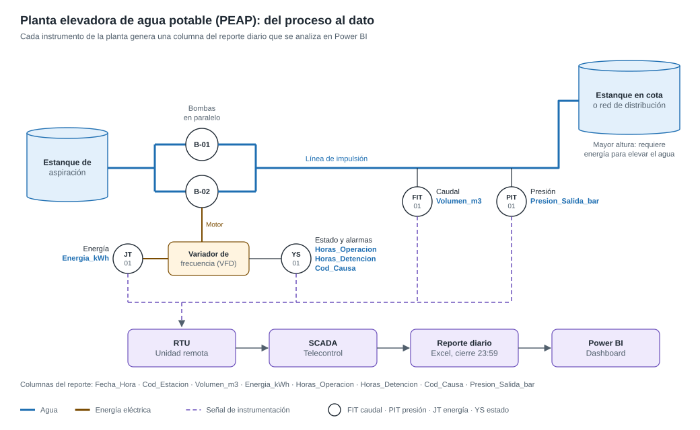
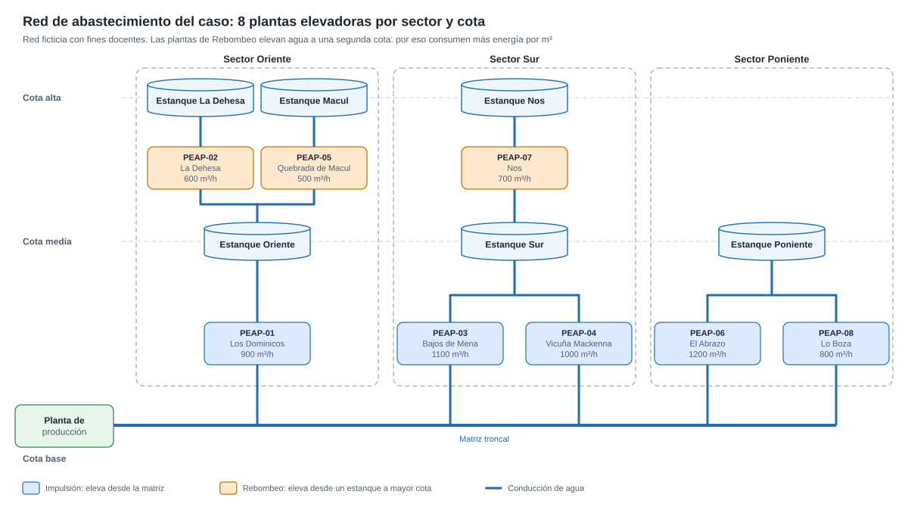

# Curso Power BI Esencial – Caso Final: Telemetría de Plantas Elevadoras de Agua Potable

Ejercicio integrador del curso **Power BI Esencial**, continuación del [Curso de Python para análisis de datos](https://github.com/hpizarrog-industry40/CursoPython). Es el ejemplo base del trabajo final (Solemne 2) y usa la misma estructura de entrega.

El caso simula la operación de 8 Plantas Elevadoras de Agua Potable (PEAP) de una empresa sanitaria durante el primer trimestre de 2026, a partir de los registros diarios que exporta el sistema SCADA de telecontrol. **Los datos son ficticios.**

## El proceso que vas a analizar

Cada planta bombea agua a una cota mayor. Sus instrumentos envían los datos a la RTU y al SCADA, que genera el reporte diario que analizarás en Power BI.



Las 8 plantas del caso se reparten en 3 sectores. Las de **Rebombeo** elevan agua desde un estanque a una segunda cota.



El significado de cada columna, su instrumento y su unidad están en el [diccionario de datos](docs/diccionario_datos.md). Los esquemas se pueden abrir y editar en [diagrams.net](https://app.diagrams.net).

## Cómo empezar

1. Lee el enunciado: [`docs/01_Enunciado_Caso_Final.md`](docs/01_Enunciado_Caso_Final.md).
2. Descarga el repositorio (**Code → Download ZIP**) y descomprímelo en una ruta corta, por ejemplo `C:\CursoPowerBI`.
3. Trabaja sobre los archivos de `01_Datos/datos_originales/`. **No los modifiques:** la limpieza se hace en la herramienta que elijas (Power Query, Python o Excel avanzado).
4. Completa cada carpeta con tu trabajo, como indica la sección 6 del enunciado.

## Estructura

```
CursoPowerBI/
├── 01_Datos/
│   └── datos_originales/        ← datos crudos exportados del SCADA (con errores)
│       ├── Operacion/Operacion_2026_01.xlsx · _02 · _03
│       ├── Estaciones.xlsx
│       └── Causas_Detencion.txt
├── 02_Programa/                 ← tu script, notebook o libro Excel de limpieza
├── 03_PowerBI/                  ← tu dashboard_consultoria.pbix
├── 04_Presentacion/             ← tu pitch de 7 láminas
└── docs/
    ├── 01_Enunciado_Caso_Final.md
    ├── diccionario_datos.md
    ├── esquema_1_proceso_peap.drawio.svg
    └── esquema_2_red_plantas.drawio.svg
```

Al terminar, agrega `01_Datos/datos_limpios.xlsx` con la base depurada y comprime todo como `Grupo_XX_Solemne2.zip`.
